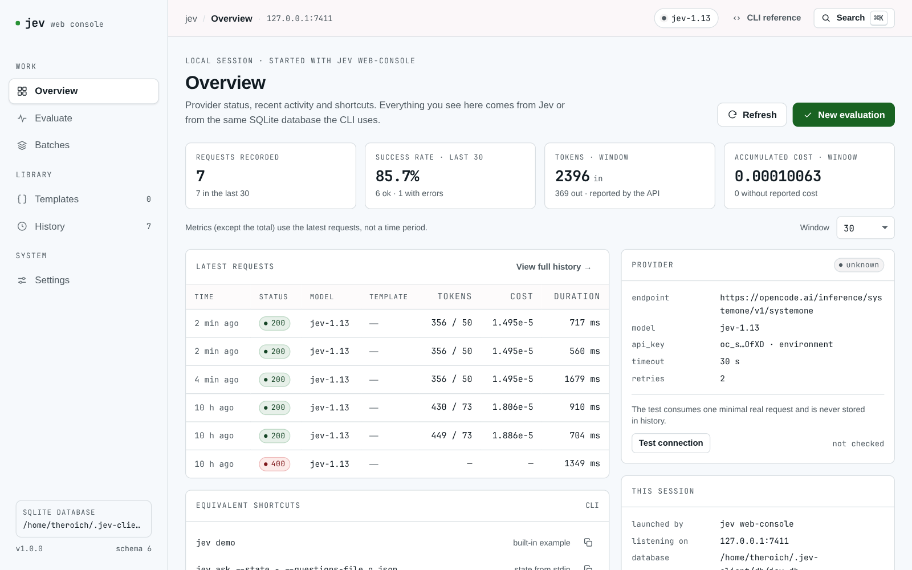
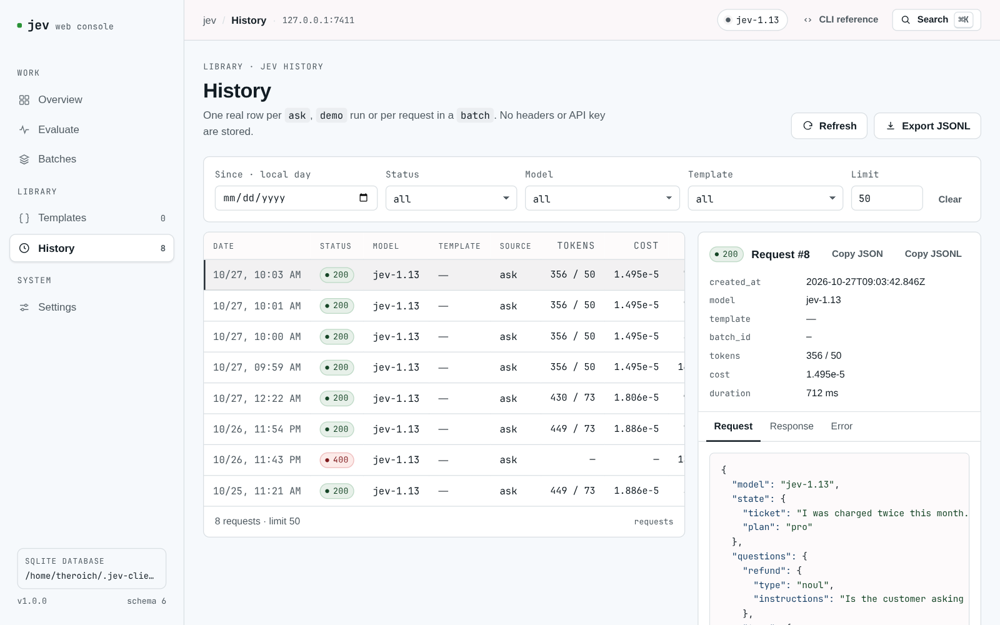

# jev-client

`jev` is a command-line tool that **asks questions to the Jev API** (TypeSafe's
System One, through OpenCode) about a text or a JSON payload.

Jev does not write answers: it **classifies**. You pass it a material (`state`)
and one or more questions, and it returns one answer per question with
probabilities. For example, you can ask whether a ticket is urgent, which team
should handle it, or how much anger it conveys.

```sh
jev ask --state "I was charged twice this month." \
  --noul 'billing=Is this about billing?'
```

```
model: jev-1.13
  billing: noul=0.9
tokens: 283 in / 20 out, cost=1.189e-5
```

Besides the CLI, it includes a **TUI**, a **local web console** and an **MCP
server** for an agent to use. They all share the same configuration and the same
history.

- [Installation](#installation)
- [First step: the API key](#first-step-the-api-key)
- [Check that everything works: `jev demo`](#check-that-everything-works-jev-demo)
- [Ask questions: `jev ask`](#ask-questions-jev-ask)
- [Repeat questions with templates](#repeat-questions-with-templates)
- [Ask in batch: `jev batch`](#ask-in-batch-jev-batch)
- [Browse the history](#browse-the-history)
- [Interactive mode: `jev tui`](#interactive-mode-jev-tui)
- [Local web console](#local-web-console)
- [Use Jev from an agent (MCP)](#use-jev-from-an-agent-mcp)
- [Analyze images](#analyze-images)
- [Common problems](#common-problems)

## Installation

You need **Node.js 22.13+** (22 LTS, 24 LTS or 26 LTS) and an API key from
[OpenCode Console](https://opencode.ai/console).

```sh
cd jev-client
npm install
npm run build
```

To have the `jev` command available in any folder:

```sh
npm link          # optional
jev demo
```

You can also run it without linking it:

```sh
node dist/src/bin.js demo
npm start -- demo
npm run dev -- demo   # builds and runs
```

If you install the published package:

```sh
npm install -g jev-client
jev --help
```

## First step: the API key

The fastest way is to pass it through an environment variable:

```sh
export OPENCODE_API_KEY="sk-..."
```

or store it so you don't have to repeat it:

```sh
jev config set api_key "sk-..."
```

> The key stored with `jev config set` stays in clear text in your local
> database. If you don't want to persist it, use `OPENCODE_API_KEY`,
> `JEV_API_KEY` or `--key`.

Check what is configured:

```sh
jev config list
jev config get model
jev config get api_key          # prints it masked
jev config get api_key --reveal # prints it in full
```

Change the model or the timeout permanently:

```sh
jev config set model jev-1.13
jev config set timeout 30
jev config set retries 2
jev config unset model          # goes back to the default value
jev config path                 # path of the database in use
```

The precedence is **flag > environment variable > stored value > default
value**. Full detail in [`docs/configuration.md`](docs/configuration.md).

## Check that everything works: `jev demo`

```sh
jev demo
```

```
model: jev-1.13
  frustration: score=1.99 ≈ "Very angry" (confidence=0.98)
    2=0.99, 1=0.01, 0=0
  is_urgent: noul=0.99
  team: choice=infra (confidence=0.52)
    infra=0.68, billing=0.32, sales=0
tokens: 449 in / 73 out, cost=1.886e-5
```

The exact probability varies slightly on each call: what matters is the chosen
option and its confidence.

It is a built-in example with urgency, team and frustration. If you see answers
and tokens, the key and the connection work.

`--json` prints the raw API response, useful to process it with another tool:

```sh
jev demo --json | jq '.answers'
```

## Ask questions: `jev ask`

### Three ways to ask

Jev supports three question types. All of them can be written directly on the
command line.

**Yes/no (`noul`)** — returns a probability between 0 and 1:

```sh
jev ask --state "I was charged twice this month." \
  --noul 'billing=Is this about billing?'
```

```
model: jev-1.13
  billing: noul=0.9
tokens: 283 in / 20 out, cost=1.189e-5
```

**Pick an option (`choice`)** — you describe the options with `--option`:

```sh
jev ask --state "The checkout has been down for 30 minutes." \
  --choice 'team=Which team should handle the incident?' \
  --option 'team.billing=Charges, invoices or payments' \
  --option 'team.infra=Outages, 500 errors or platform problems' \
  --option 'team.sales=Pricing or sales questions'
```

```
model: jev-1.13
  team: choice=infra (confidence=0.61)
    infra=0.74, billing=0.26, sales=0
tokens: 354 in / 38 out, cost=1.487e-5
```

**Score (`score`)** — levels are added in order, from lowest to highest:

```sh
jev ask --state "We have had no reply for two days." \
  --score 'urgency=How urgent is the incident?' \
  --level 'urgency=It can wait' --level 'urgency=This week' \
  --level 'urgency=Today'
```

```
model: jev-1.13
  urgency: score=1.29 ≈ "This week" (confidence=0.47)
    1=0.65, 2=0.32, 0=0.03
tokens: 312 in / 18 out, cost=1.310e-5
```

`score` returns a weighted average and may come out as a decimal; when it falls
between two levels it is shown with `≈`.

You can combine several questions in a single call: they are evaluated against
the same `state` and each one receives an answer.

```sh
jev ask --state "I was charged twice and I want a refund." \
  --noul 'refund=Is a refund requested?' \
  --choice 'team=Which team should handle it?' \
  --option 'team.billing=Charges' --option 'team.legal=Claims' \
  --score 'urgency=How urgent is it?' \
  --level 'urgency=It can wait' --level 'urgency=Today'
```

### What is sent as `state`

It can be plain text, a JSON object or an array:

```sh
jev ask --state "The customer is angry." --noul 'angry=Is the customer angry?'

jev ask --state '{"ticket":"I was charged twice","plan":"pro"}' \
  --noul 'refund=Is a refund requested?'

jev ask --state '["error 500","checkout down"]' \
  --noul 'infra=Is this a platform problem?'
```

If the text starts with `{` or `[`, it is sent as JSON; otherwise, as a string.

### Read the material from stdin or from files

```sh
echo "The checkout is down" | jev ask --state - \
  --noul 'urgent=Is it urgent?'
```

```sh
jev ask --state-file examples/state.json \
        --questions-file examples/questions.json
```

`examples/state.json` is the material and `examples/questions.json` the
questions. Useful when the JSON is long or another program generates it.

### Full payload

If you already have the Jev request as is (`model`, `state` and `questions`):

```sh
jev ask --request-file examples/request.json
```

It also accepts inline JSON with `--request '{"..."}'`.

### Choose model, endpoint and timeout

```sh
jev ask --model jev-1.13-free \
  --url https://opencode.ai/inference/systemone/v1/systemone \
  --timeout 60 --retries 3 \
  --state "hello" --noul 'q=Is it a greeting?'
```

Useful flags in `ask`, `demo` and `batch`:

| Flag | What it is for |
| --- | --- |
| `--json` | prints the raw API response |
| `--no-save` | does not save this run in the history |
| `--db <path>` | uses another database |
| `--key <key>` | API key for this run only |
| `--model <model>` | model for this run only |
| `--url <endpoint>` | full endpoint for this run only |
| `--timeout <s>` / `--retries <n>` | timeout and retries |

## Repeat questions with templates

A **template** is a Jev request with blanks (`{{key}}`) that are filled in with a
context. It saves you from repeating the same JSON every time.

### Create a template

The file [`examples/template.json`](examples/template.json) contains:

```json
{
  "model": "jev-1.13",
  "state": {
    "order": "{{order_state}}",
    "customer": "{{customer.name}}",
    "plan": "{{customer.plan}}"
  },
  "questions": {
    "urgent": { "type": "noul", "instructions": "Is it urgent?" }
  }
}
```

Save it under a name:

```sh
jev template create order \
  --description "Customer order with macros" \
  --file examples/template.json \
  --macro-desc 'order_state=What the customer is asking for, as free text' \
  --macro-desc 'customer.name=Customer name' \
  --macro-type 'customer.plan=string'
```

```
template saved: order
```

Macros are detected from the body on their own. `--macro-desc` and
`--macro-type` are optional: they add a description and a type so the template
is easier to understand in the TUI, the web console and agents.

You can also pass the body inline or through stdin:

```sh
jev template create greeting --body '{"model":"jev-1.13","state":"{{text}}","questions":{"q":{"type":"noul","instructions":"Is it a greeting?"}}}'
cat body.json | jev template create greeting --body -
```

`jev templates` is an alias of `jev template`.

### Show and validate

```sh
jev template list
# order - Customer order with macros

jev template show order
```

`show` prints the body and the list of macros with their description and schema.

```sh
jev template validate order
# template valid: order
```

`validate` checks the template without calling Jev. It also accepts a file:

```sh
jev template validate --file examples/template.json
```

### Fill in and preview

The context is a JSON object with one key per macro. For example,
[`examples/context.json`](examples/context.json):

```json
{
  "order_state": "I was charged twice and I want a refund.",
  "customer": { "name": "Ana", "plan": "pro" }
}
```

```sh
jev template render order --context-file examples/context.json
```

```
{
  "model": "jev-1.13",
  "state": {
    "order": "I was charged twice and I want a refund.",
    "customer": "Ana",
    "plan": "pro"
  },
  "questions": {
    "urgent": {
      "type": "noul",
      "instructions": "Is it urgent?"
    }
  }
}
```

`render` does not call Jev. To run the result:

```sh
jev template render order --context-file examples/context.json > /tmp/request.json
jev ask --request-file /tmp/request.json
```

Macro rules:

- `{{key}}` looks up the key in the context. Nested paths are supported
  (`{{customer.name}}`); if a literal key with dots exists, it takes precedence.
- If the text is **exactly** a macro, the value is inserted with its native type
  (object, array, number, boolean). If it is embedded in a sentence, it is
  interpolated as text.
- `\{{...}}` leaves the macro written without resolving it.
- If any macro is missing, the command fails **before** calling the API and lists
  every missing key.

### Edit, describe and delete

```sh
# Open the body in $EDITOR
jev template edit order

# Replace the body from a file
jev template edit order --file new-body.json

# Add, change or clear metadata without touching the body
jev template edit order --macro-desc 'customer.plan=Contracted plan'
jev template edit order --clear-macro-desc 'customer.name'
jev template edit order --clear-macro-schema 'customer.plan'

# Delete (asks for confirmation)
jev template delete order
jev template delete order --yes
```

`jev template add` and `jev template remove` are quick synonyms of `create` and
`delete` without confirmation.

## Ask in batch: `jev batch`

Runs a template once for each context of a JSON array. Every request ends up in
the history under the same `batch_id`.

[`examples/contexts.json`](examples/contexts.json):

```json
[
  {
    "order_state": "I was charged twice and I want a refund.",
    "customer": { "name": "Ana", "plan": "pro" }
  },
  {
    "order_state": "The checkout hangs when I try to pay.",
    "customer": { "name": "Luis", "plan": "free" }
  },
  {
    "order_state": "I never received this month's invoice.",
    "customer": { "name": "Marta", "plan": "pro" }
  }
]
```

```sh
jev batch order --contexts examples/contexts.json
```

```
batch: order — 3 requests (batch 4f3c…)
  1: ok    jev-1.13  306 in / 20 out  cost=1.3e-5
  2: ok    jev-1.13  302 in / 20 out  cost=1.3e-5
  3: ok    jev-1.13  302 in / 20 out  cost=1.3e-5
summary: 3 ok, 0 error
tokens: 910 in / 60 out
cost: 3.8e-5
```

If a context does not fit the template, that row shows the error and the rest
continues:

```
  2: error missing macros in context: customer.plan
```

Options:

```sh
# Up to 3 requests at a time (maximum 10)
jev batch order --contexts examples/contexts.json --concurrency 3

# Stop at the first error (by default it continues with the rest)
jev batch order --contexts examples/contexts.json --fail-fast

# Read the contexts from stdin
cat contexts.json | jev batch order --contexts -
```

With `--continue-on-error` (the default), an invalid context does not cancel the
rest; the process exits with code `1` if there were errors. Results are printed
in file order, even though they run in parallel.

## Browse the history

Every run of `ask`, `demo` and `batch` is saved in a local SQLite database,
including the ones that fail.

```sh
jev history list                # one line per request, most recent first
jev history show 12             # full request and response
jev history export > hist.jsonl # one request per line (JSONL)
```

Filter:

```sh
jev history list --limit 20
jev history list --status 429
jev history list --model jev-1.13
jev history list --template order
jev history list --batch 4f3c…
jev history list --since 2026-10-01T00:00:00Z
```

To avoid saving a particular run, add `--no-save` to `ask`, `demo` or `batch`.
The database lives in `~/.jev-client/db/jev.db` and can be changed with `--db` or
`JEV_DB`. Technical detail in [`docs/persistence.md`](docs/persistence.md).

## Interactive mode: `jev tui`

To configure the provider and manage templates without memorizing commands:

```sh
jev tui
jev tui --db /path/jev.db
```

It has two areas:

- **Provider settings**: `api_url`, `api_key`, `model`, `timeout` and `retries`,
  with validation while you type. The key is shown masked.
- **Templates**: search, show, create, edit and delete. While editing, the JSON
  is validated live and the detected macros are shown.

| Key | Action |
| --- | --- |
| `↑` / `↓` | move the selection |
| `Enter` | choose / confirm |
| `Esc` | cancel / go back |
| `q` | return to the menu (or quit) |
| `Ctrl-C` | quit (asks for confirmation if there are unsaved changes) |
| `n` / `e` / `d` / `/` | in templates: new, edit, delete, search |

Changes are saved in the same database used by `jev config` and `jev template`,
so they are visible from outside the TUI. Without an interactive terminal
`jev tui` exits with an error and suggests the equivalent commands.

## Local web console

A graphical interface with the same features, no account and no telemetry:

```sh
jev web-console
jev --web-console              # alias
jev web-console --port 0 --no-open
```

It opens the URL it prints in the browser; this is the Overview screen:



Screens:

| Screen | What it is for |
| --- | --- |
| **Overview** | state, metrics and connection test |
| **Evaluate** | launch `noul`, `choice` and `score` questions and see probabilities |
| **Templates** | create, edit, validate and render, with a description and type per macro |
| **Batches** | paste an array of contexts, run it and follow the progress |
| **History** | filter, see the detail and export |
| **Settings** | edit the configuration and reveal the key only if you ask for it |

Evaluate runs the questions in the order of the form and shows one answer per
question with its probabilities and the CLI equivalent:


History filters the same SQLite rows the CLI writes, shows the detail per tab and
is exported as JSONL:



Every screen shows the equivalent CLI command. `--port`, `--host`,
`--allow-remote`, `--open`/`--no-open`, `--dev` and the session flags are
explained in [`docs/web-console.md`](docs/web-console.md), together with the
security model. `--allow-remote` exposes an administration console: use it only
on trusted networks.

## Use Jev from an agent (MCP)

The MCP server lets an agent discover templates, fill in contexts and run
requests without you translating the CLI.

```sh
jev mcp                          # server over stdio
jev-mcp                          # alias
jev mcp --read-only              # read-only
jev mcp --no-execute             # without executing against Jev
jev mcp --allow-destructive      # allows deleting templates
```

Configuration in `opencode.json`:

```jsonc
{
  "$schema": "https://opencode.ai/config.json",
  "mcp": {
    "servers": {
      "jev": {
        "type": "local",
        "command": ["node", "dist/src/mcp-bin.js"],
        "environment": { "JEV_DB": "/Users/me/.jev-client/db/jev.db" }
      }
    }
  }
}
```

With the npm package:

```jsonc
{
  "mcp": {
    "servers": {
      "jev": { "type": "local", "command": ["npx", "-y", "jev-client", "mcp"] }
    }
  }
}
```

Besides the fixed catalog (`jev_ask`, `jev_batch`, `jev_template_*`,
`jev_history_*`, etc.), **every saved template is exposed as a tool** with its
macros as parameters. Full catalog, resources and permissions in
[`docs/mcp.md`](docs/mcp.md).

## Analyze images

The API accepts images in an `assets` field, referenced from the `state`. From
the CLI:

```sh
jev ask --state '{"photo":"cat"}' \
  --asset cat=photo.jpg \
  --choice 'animal=Which animal appears in `photo`?' \
  --option 'animal.CAT=Domestic feline' \
  --option 'animal.DOG=Domestic canine'
```

- `--asset [<ref>=]<path>` can be repeated; without `<ref>` a UUID is generated.
- `--assets-file <path>` reads a complete `assets` map in JSON.
- Formats: static PNG/JPEG, up to 16 MiB, sides of 280–1568 px.

The image must be referenced in `state`, `instructions` or `criteria`, and the
API does not resize it nor apply the EXIF orientation. Limits, pitfalls and the
protocol detail in [`docs/images.md`](docs/images.md).

## Common problems

**Unsupported Node version.** `jev` uses the built-in `node:sqlite` module and
needs **Node.js 22.13+**. On an older runtime it exits with code `1` and:

```text
jev requires Node.js >= 22.13; found <version>.
```

Upgrade to Node 22 LTS, 24 LTS or 26 LTS. There is no native binary to rebuild.

**The database uses a newer schema.** Another version of `jev` wrote into the
same database. Use a temporary database:

```sh
jev ask --db "$(mktemp -d)/jev.db" --state "hello" --noul 'q=Is it a greeting?'
```

**`429 FreeUsageLimitError`.** `jev-1.13-free` is limited outside OpenCode or
once the quota runs out. Use `jev-1.13` for tests.

**`401` / `api_key_expired`.** Check the key with
`jev config get api_key --reveal` or export `OPENCODE_API_KEY` again.

**`422`.** The question is malformed: `choice` uses an object in `criteria` and
`score` uses an ordered array.

**The web console does not start.** Check the port (`--port 0` picks a free one)
and that the build exists (`npm run build:web`). More cases in
[`docs/troubleshooting.md`](docs/troubleshooting.md).

### Exit codes

| Code | Meaning |
| --- | --- |
| `0` | Success |
| `1` | API, network or configuration error (missing key, invalid JSON…) |
| `2` | Wrong usage (invalid command or flags) |

Authentication errors (`401` / `api_key_expired`), quota
(`FreeUsageLimitError`) and malformed questions (`422`) add a `hint:` line with
the recommended action.

## Technical documentation

The README is a usage guide. Implementation detail lives in
[`docs/`](docs/README.md): architecture, persistence, configuration, question
types, web console, MCP, images, use as a library and development.

For scripting by use case, see also the
[`skills/jev-cli/`](skills/jev-cli/SKILL.md) skill.
